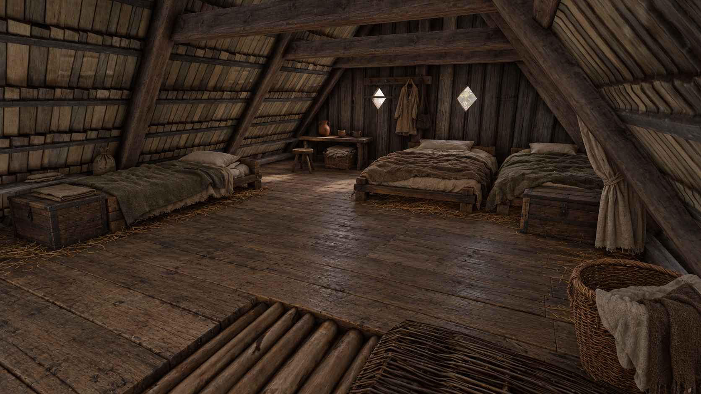

# Forge loft furnishing target

Status: wall-aligned revision implemented in the shared layout and applied as a
live visual preview. Permanent package installation and interaction verification
are pending. The image below is a generated concept, not a runtime screenshot.

Latest revision follows the user's downstairs-room reference: matching complete
`bed_rustic_d` beds run along the perimeter, the parents' beds lie end-to-end along
the back wall, and Henry's bed follows the left wall. Chests are against the side
walls, away from the parents' access strip. The basket is beside the table.
Separate blanket overlays and the loose floor clothing have been removed.
Five native board variants have deterministic width/length variation, staggered
joints and end-for-end rotations. Room axes follow the house's one-degree yaw.
The user supplies screenshots for visual review; Computer Use is not needed.



## Why the draft failed visually

Thin identical bedrolls, isolated furniture and oversized foreground sacks made
the room read as storage. Rotating objects slightly did not create household
purpose. The broad mottled floor dominates the view. The tall empty shelving
reads like another ladder. More random props would amplify those problems.

## Build order and asset decisions

1. **Three dressed beds.** Henry along the left eave; two separate parents' beds
   grouped lengthways along the far wall. Use low rough timber frames,
   thick mattresses, pillows and rumpled plain wool covers. No elaborate bedheads.
   Preserve three distinct native bed contracts and ownership. Do not just raise
   the existing low-bed visual: sleeping-helper heights must match its mattress.
2. **Floor finish.** Inspect the existing loft surface material first. Aim for
   worn plank appearance from the concept without changing the ladder exit
   height or introducing overlapping collision. A fitted visual floor needs
   explicit dimensions and must leave the ladder opening intact. The current
   preview uses a fitted visual layer of five native rough-board variants.
3. **Bedside storage.** Two low chests: Henry's linked shared stash and separate
   household storage beside the parents. Keep lid sweep and interaction space.
   Folded linen on a closed lid must move with it or be placed elsewhere.
4. **Household corner.** Replace the tall empty shelf with a low bench/small table.
   Put the jug and two cups on its actual top; stool and laundry beside it.
   Measure the support surface rather than guessing item heights.
5. **Personal belongings.** Short peg rail, worn tunic/apron and satchel on the
   back wall. These need compatible static hanging meshes and wall-clearance checks.
6. **Restrained finishing.** One small storage sack tucked into an eave, folded
   linen, and sparse flat straw around bedding. Remove the oversized foreground
   sack group, isolated central stool/jug, loose hay mound and fancy rug.
7. **Light.** Compare the completed furniture under current baked lighting first.
   The generated image is brighter; it is not evidence that runtime indirect
   lighting is fixed. Keep the existing windows and avoid decorative light spam.

The optional tied linen screen in the concept is secondary: add only if an
appropriate mesh fits without blocking bed access or clipping the roof.

## Reference basis

- [Weald & Downland: Hangleton](https://www.wealddown.co.uk/buildings/medieval-building-hangleton/)
  describes sleeping chambers also used for storage and warns that reconstructed
  upper structures are conjectural.
- [Bayleaf medieval farmstead booklet](https://www.wealddown.co.uk/wp-content/uploads/2020/12/The-Bayleaf-Medieval-Farmstead-booklet.pdf)
  describes grouped family bedding with personal storage at the bed foot.

These English museum references inform household organization, not an exact
reconstruction of a Bohemian forge loft. The game room geometry remains the constraint.

## Reusable authoring helpers

`tools/room_layout.py` accepts a plain layout dictionary/JSON:

```python
layout = {
    'origin': (735, 3420, 67.303),
    'groups': {'henry': {'offset': (-1.95, -.4, 0), 'yaw': 0}},
    'items': [
        {'name': 'personal_chest', 'group': 'henry',
         'offset': (-.1, -1.9, 0), 'yaw': 84,
         'model': 'gluebuild/player_chests/1/chest02.cga',
         'kind': 'chest', 'owner': 'player', 'shared': True,
         'footprint': (-.700619, -.014058, .700551, .488125)},
    ],
    'clearances': [
        {'name': 'ladder_landing', 'offset': (2.6, -3.4, 0),
         'footprint': (-.6, -.7, .6, .5)},
    ],
}
```

- `resolve(layout)` composes room/group/item transforms. Positions use metres;
  input yaw uses degrees, resolved yaw uses radians, rotations use engine wxyz.
- `check_clearances(layout)` tests measured rotated footprints against authored
  keepout rectangles. It reports unmeasured objects explicitly. It does not
  certify sloping-roof clearance, collisions, chest animations or AI navigation.
- `geometry(item)` emits a static visual template for the package converter.
- `boarded_surface(...)` fits measured board meshes to a rectangular area with
  seeded width, length, joint and orientation variations. It retains the existing
  collision surface; it does not generate navigation or structural geometry.
- `preview_lua(layout, 'gm_preview_forge_loft_')` generates Lua for a bounded
  visual-only preview. Repeating it updates existing previews and removes stale
  objects only if their name and runtime ID are owned by that preview registry.
  Foreign name collisions fail before any changes. `cleanup=True` removes owned
  preview entities only. Run generated Lua through the normal live-game bridge.
- CLI: `python tools/room_layout.py layout.json --preview preview.lua
  --prefix gm_preview_forge_loft_` resolves/checks without executing game code.

`tools/forge_loft_layout.py` is the current concrete layout. `forge_loft.py`
consumes its resolved placements and independently creates native bed triggers,
healing hubs, owners, parent sleep links and shared chest links. Both helper
modules are listed in setup's converter inventory.

The authored package was installed for a bounded retail playtest on 2026-10-22.
Both parents' beds moved 0.35 m right along the back wall. The package also moves
the downstairs wheelbarrow and its basket and removes the horizontal prop ladder.
CRC, archive hashes, repeated conversion, preserved schedule activities, mounted
table aliases and serialized ownership/assignment links passed offline checks.
The installation journal and rollback archives are in
`D:/BuildKCDMod/forge-loft-final-20261022/retail-install`.

Runtime checks remain: compare all three sleeping poses against the furniture,
verify parent routes and both ladder exits, check chest ownership and shared
storage, and repeat after save/load. Generated concept art is not test evidence.
The preceding visual-preview session ended with a fatal FMOD allocator failure
in a 140 MiB audio pool. Its underlying cause is unresolved; this installation
does not claim to fix that crash. The crash log was preserved separately.

### Interaction correction, version 2

The first installed test was rejected: all three beds showed prompts but did
not sit/sleep and did not block walking. Live physics rays hit the original
floor at about 67.3026 instead of the mattresses; rephysicalizing GeomEntity
did not restore collision. The parents' click hint inherited the generic
`ui_hud_use_item_not_owner` string, displayed as "Steal food". The family chest
also faced the wall, so its native approach-angle check rejected room-side use.

Version 2 was installed as the next playtest. Solid authored furniture uses
native BasicEntity, whose SetupModel loads the mesh before physicalization;
floor decoration remains nonphysical. Bed click hints explicitly say Sit.
The shared animation adapter now references the native collection for
Bed_1Place helpers (the high-bed collection is used by 121 Trosky rows), retaining
runtime validation at the imported coordinates. The family chest faces inward.
The v1 migration preserves entity identities, owners, inventory links, schedules
and downstairs brush edits. Repeating it is byte-identical.

Installation/rollback journal:
`D:/BuildKCDMod/forge-loft-interactions-v2-20261022/retail-install/installation.json`.
This candidate has passed offline checks; collision, sitting, sleeping and chest
use after restart are still pending. Do not infer playability from those checks.

### Parent schedules and setup

Mother and Father each have an explicit `sleepBed` link to their own loft bed,
with the reciprocal `preferedSleeper` link and serialized ownership. Their
existing sleep pools prefer those beds at priority 100; the daytime schedules,
quest priorities and fallback places remain intact. In the verified installed
package Mother's window is 22:12–06:52 and Father's is 20:13–06:46. These times
come from the generic job-based clock calculation, not fixed loft-specific hours.

Recipe 49 runs the loft converter after profile population in shared setup
finalization, used by both clean builds and package upgrades/resume. The generic
sleep upgrader also reads explicit household assignments on subsequent passes.
Tests cover reprocessing the assignment without replacing daytime activities,
and setup finalization calling the converter and retaining its receipt.
The source changes are included in setup's converter inventory; publishing a
new executable release is a separate operation.

### Waking hours, compound furniture and lights, version 3

The next live check found Mother sweeping at about 01:04, within her sleep
window. Her ordinary generated work still had a 00:00–24:00 interval. The
generic sleep upgrader now subtracts validated sleep intervals from ordinary
converter-owned work. Quest, privileged and conditional links stay unchanged.
Daytime sleep can split a night worker's work interval into two ranges. The
operation is repeatable and household assignment upgrades use the same rule.

BasicEntity loading alone did not solve bed collision: live rays still hit
the floor beneath all three mattresses. The native bed asset is compound, with
a separate shadow root. Explicitly loading its `WH_MergeNode007` furniture
component made rays hit the mattress at about 67.7715. The room helper now
accepts `subobject`, using the native component loader with static physics,
invulnerability, no pickup/use action, no vulnerability and explosions disabled.
An isolated spawn through this exact loader also passed the mattress ray test.
Version 3 migrates existing furniture without changing bed/schedule identities.
Father still remained in MotionIdle after the live collision correction;
successful bed entry is not yet demonstrated.

Recipe 50 also expands active source Fires procedural prefabs into native
light/particle entities. The real source audit accounts for 1,760 objects:
1,470 registered, 290 already controlled by converted cooking fireplaces,
and zero unsupported in the tested package. It preserves inactive layers and
avoids duplicate cooking flames. The loft table receives a native small candle
with its mesh, flame and flickering light. IDs and repeated output are stable;
unsupported resources are reported rather than replaced with invented effects.

The staged candidate is `D:/BuildKCDMod/forge-loft-sleep-lights-v3-20261022`.
Archive CRC, repeat conversion, mounted scheduler/animation aliases and parent
work/sleep intervals pass. Runtime sleep, parent routes, lighting appearance,
performance and save/load remain playtest requirements. This is source/setup
integration; the already-running setup executable has not been rebuilt.

### Midnight follow-up: sleep is not yet accepted

The user confirmed the candles work after the v3 install, but neither parent
was sleeping; Mother was still sweeping at midnight. Live reads during the
night found Mother downstairs and Father moving near the public fallback
area, rather than occupying his assigned loft bed. The work intervals were
already bounded in the installed scheduler, so changing the clock alone did
not resolve this failure.

Two additional schedule corrections are now in the shared converter: bounded
ordinary work uses `HaltOnInvalid=true`, and both the sleep-pool entity and its
compiled hub are positioned at the highest-ranked bed. Previously the pool
retained its original public-bed position after adding a household assignment.
These are source corrections, not a verified retail sleep result.

The installed base navigation has no connection for the authored loft ladder
(`c9ef1513-ef3d-d45f`). A comparison of the exported native Trosky base mesh
finds category-3 connections for all 58 registered ladders. Interactive ladder
registration and solid loft furniture do not establish NPC traversal. The
loft still needs a validated navigation route, including its landing and bed
approach areas; no invented connection or foreign world-space bake has been
installed. Cancellation, parent traversal, actual lying poses and wake-up
remain unverified. Do not describe the schedule changes as a complete fix.

The subsequent [parent sleep audit](parent-sleep-audit.md) confirms an additional
generic mismatch: 100 source ladder navigation links retain category 2 and
source GUIDs, whereas native KCD2 ladders use category 3 and matching registered
GUIDs. It also qualifies the cancellation hypothesis: `HaltOnInvalid=false`
is common in native timed activities and does not by itself prove the cause.
The user confirmed that Henry can already sleep in all three beds.

## Image provenance

Generated with the built-in image generation tool from the user's supplied loft
screenshot. Full generation prompt is saved beside the concept image in
`images/forge-loft-concept-01.prompt.txt`. No game archives were changed by this
design pass.
